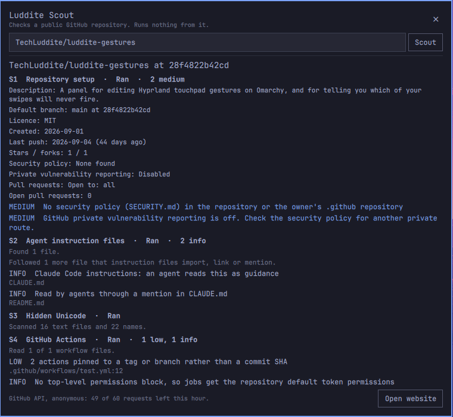

# Luddite Scout

A pre-flight check for a public GitHub repository, run before you point a coding agent at it, build it, or install it. Give it a repository and get a report a person can read in a few minutes. It never runs code from the repository.

**Status:** experimental, under active development.

Three ways to use it, all running the same checks:

- **Website:** https://techluddite.github.io/Luddite-Scout/. Everything runs in your browser.
- **Terminal:** `bin/scout owner/repo`. One Python file, standard library only.
- **Omarchy:** a bar widget and panel for the Omarchy desktop.

## Credits

Luddite Scout is a thin layer over public services and published research. It has no code dependencies.

Data sources:

- [GitHub REST API](https://docs.github.com/en/rest) and raw.githubusercontent.com for repository details, file lists and file contents.
- [OSV](https://osv.dev), the open source vulnerability database and [API](https://google.github.io/osv.dev/api/) run by Google, for dependency advisories (S5).
- [OpenSSF Scorecard](https://scorecard.dev) from the [Open Source Security Foundation](https://openssf.org), for repository security scores where a repository has been scanned (S5).

Research the checks are based on:

- [Trojan Source](https://trojansource.codes) by Nicholas Boucher and Ross Anderson, on bidirectional control characters that make code display differently from how it runs (S3).
- [ASCII Smuggler Tool: Crafting Invisible Text and Decoding Hidden Codes](https://embracethered.com/blog/posts/2024/hiding-and-finding-text-with-unicode-tags/) on the Embrace The Red blog, on Unicode tag characters used to hide instructions from people while AI models still read them (S3).
- GitHub Security Lab on [pwn requests](https://securitylab.github.com/resources/github-actions-preventing-pwn-requests/) and [untrusted input](https://securitylab.github.com/resources/github-actions-untrusted-input/), and GitHub's [security hardening guide for Actions](https://docs.github.com/en/actions/security-for-github-actions/security-guides/security-hardening-for-github-actions) (S4).
- The review history of the [Omarchy plugin marketplace](https://github.com/omacom/omarchy-plugin-marketplace), for the patterns its reviewers block most often (S7).

## What it checks

| Check | What it looks for |
| --- | --- |
| S1 Repository setup | Security policy, private vulnerability reporting, licence, archive and fork status, open pull requests |
| S2 Agent instruction files | CLAUDE.md, AGENTS.md, GEMINI.md, `.claude/`, `.agents/`, `.gemini/`, `.mcp.json`, editor tasks that run on open, dev container commands. Cross-checks: whether CLAUDE.md, AGENTS.md and GEMINI.md in one folder match or point to each other, or give different agents different instructions. Redirects: `@` imports (including ones outside the repository or from a web address), symbolic links, files the instructions mention, renamed Gemini CLI instruction files, extra folders and endpoint changes in settings, and HTML comments GitHub hides. Files that instructions send an agent to are scanned too |
| S3 Hidden Unicode | Bidirectional controls, tag characters and zero-width characters in file contents and names |
| S4 GitHub Actions | `pull_request_target` checking out PR code, untrusted input inside `run:` steps, unpinned actions, broad permissions |
| S5 Dependencies | Lockfiles checked against [OSV](https://osv.dev), plus the [OpenSSF Scorecard](https://scorecard.dev) result where one exists |
| S6 Build-time code | `build.rs`, npm install scripts, `setup.py`, `.envrc` and other code that runs on install, build or entry |
| S7 Omarchy plugin | Only for repositories that are Omarchy plugins: markup-rendering `Text` items, uncapped process output, shell command strings, `sudo`, run-time installs, agent files shipped with the plugin |

S1 to S6 apply to any repository. S7 reports "not applicable" unless the repository has an Omarchy plugin manifest at its root.

Each check reports whether it ran in full, ran partially, was skipped, or does not apply, with the reason. A skipped check is never shown as a pass. Findings are pattern matches for a human to judge. A clean report is not proof that a repository is safe.

## What a report looks like

These examples scan the author's own repositories.

The summary for [TechLuddite/NetReady](https://github.com/TechLuddite/NetReady), a website project, so S7 does not apply:


The S7 card for [TechLuddite/luddite-gestures](https://github.com/TechLuddite/luddite-gestures), an Omarchy plugin, with each finding linked to the line it came from:


## Website

Open https://techluddite.github.io/Luddite-Scout/ and enter `owner/repo` or a GitHub URL. To run your own copy there is no build step:

```sh
git clone https://github.com/TechLuddite/Luddite-Scout.git
cd Luddite-Scout
python3 -m http.server 8000
```

## Terminal

`bin/scout` needs only Python 3, with no packages to install. It is tested with Python 3.14.

```sh
bin/scout owner/repo                              # readable report
bin/scout --json owner/repo                       # JSON report
bin/scout --gh-token owner/repo                   # use the GitHub CLI's login for a higher rate limit
gh auth token | bin/scout --token-stdin owner/repo  # or pass any token on standard input
```

A token never goes on the command line or into the environment, where other processes could read it. `--gh-token` finds the `gh` you run by default without installing anything: it asks mise (`mise which gh`, which is how Omarchy installs `gh`) and falls back to `/usr/bin/gh`. It then runs `gh auth token` and keeps the result inside the scanner process. If GitHub rejects a token, the scan continues anonymously and the report says so. The JSON report is capped at about 1.5 MB. The lowest-severity findings are dropped first, and the report says when that happened. The readable report and the website show every finding.

## Omarchy plugin

```sh
omarchy plugin add https://github.com/TechLuddite/Luddite-Scout
omarchy plugin enable io.github.techluddite.luddite-scout
```

The bar icon opens a panel. Type a repository, press Enter, and the panel runs `bin/scout --json` under `/usr/bin/timeout` and shows the report.



The panel shows up to eight findings per check, and the website or terminal shows the rest. If you are signed in to the GitHub CLI (`gh auth login`), the panel uses that login, which raises GitHub's limit from 60 to 5,000 requests an hour. The token stays inside `bin/scout` and is sent only to `api.github.com`. Without a login the panel works anonymously. The plugin needs `/usr/bin/python3`, has no settings, and writes no files.

To remove it:

```sh
omarchy plugin remove io.github.techluddite.luddite-scout
```

Nothing is left behind: the plugin keeps no state, cache, credentials or configuration outside its own folder.

## Limitations and data handling

- Public repositories only, default branch only.
- Without a token, GitHub allows 60 API requests an hour per address. A review uses about five. File contents come from `raw.githubusercontent.com`, which does not count against that limit.
- Files over 1 MB and binary files are not scanned for hidden characters. Very large repositories may be covered partially, and the report says so.
- No AI model is used and no code from the scanned repository is run.

All three front ends contact the same four hosts and no others: `api.github.com`, `raw.githubusercontent.com`, `api.osv.dev` (package names and versions from lockfiles) and `api.securityscorecards.dev` (the repository name). Those services see your IP address and what you looked up. The website's Content Security Policy and `bin/scout`'s host allowlist block every other host, and `bin/scout` refuses redirects. Results are not stored or shareable by link. See [about.html](about.html) for the full statement.

## Development

```sh
npm test        # node --test and python3 -m unittest, no packages to install
npm run serve   # python3 -m http.server 8000
```

The checks exist twice: in `js/checks/` for the website and in `bin/scout` for the terminal and the panel. Both run the same cases from `test/fixtures/cases.json`, and finding titles must match, so a rule changed in one place and not the other fails the tests. A further test runs S3 over this repository itself.

## Help and security

For bugs and suggestions, open an issue. Please do not report security problems in public issues. Use GitHub private vulnerability reporting as described in [SECURITY.md](SECURITY.md).

## Licence

[MIT](LICENSE).
