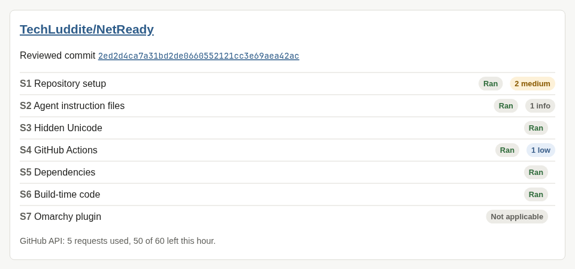
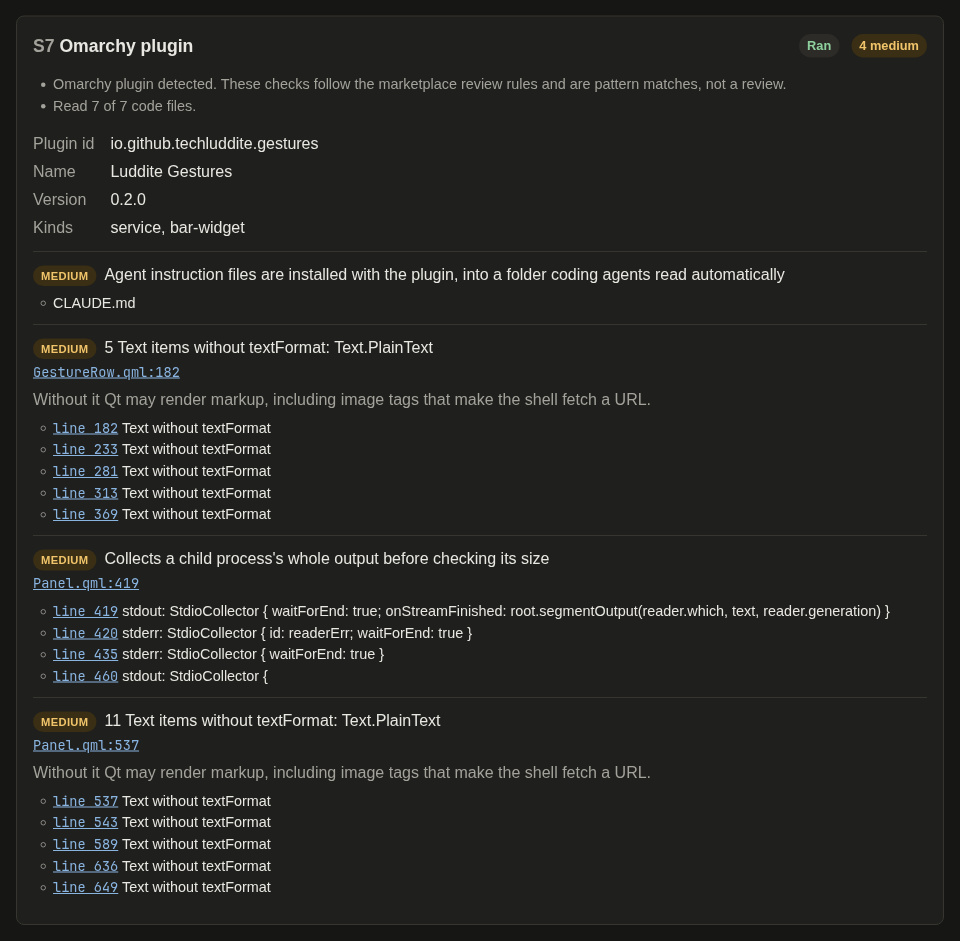

# Checks

Every front end runs the same seven checks on one commit of the repository's default branch.

| Check | What it looks for |
| --- | --- |
| S1 Repository setup | Security policy, private vulnerability reporting, licence, archive and fork status, open pull requests |
| S2 Agent instruction files | CLAUDE.md, AGENTS.md, GEMINI.md, `.claude/`, `.agents/`, `.gemini/`, `.mcp.json`, editor tasks that run on open, dev container commands. Cross-checks: whether CLAUDE.md, AGENTS.md and GEMINI.md in one folder match or point to each other, or give different agents different instructions. Redirects: `@` imports (including ones outside the repository or from a web address), symbolic links, files the instructions mention, renamed Gemini CLI instruction files, extra folders and endpoint changes in settings, and HTML comments GitHub hides. Files that instructions send an agent to are scanned too |
| S3 Hidden Unicode | Bidirectional controls, tag characters and zero-width characters in file contents and names |
| S4 GitHub Actions | `pull_request_target` checking out PR code, untrusted input inside `run:` steps, unpinned actions, broad permissions |
| S5 Dependencies | Lockfiles checked against [OSV](https://osv.dev), plus the [OpenSSF Scorecard](https://scorecard.dev) result where one exists |
| S6 Build-time code | `build.rs`, npm install scripts, `setup.py`, `.envrc` and other code that runs on install, build or entry |
| S7 Omarchy plugin | Only for repositories that are Omarchy plugins: markup-rendering `Text` items, uncapped process output, shell command strings, `sudo`, run-time installs, agent files shipped with the plugin |

S1 to S6 apply to any repository. S7 reports "not applicable" unless the repository has an Omarchy plugin manifest at its root.

## Status and findings

Each check reports one status, with the reason:

| Status | Meaning |
| --- | --- |
| Ran | The check covered everything it looks at |
| Partial | Some files or API calls were not covered, for example because of size or rate limits |
| Skipped | The check could not run |
| Not applicable | The check does not apply to this repository |

A skipped check is never shown as a pass. Findings have a severity of high, medium, low or info. They are pattern matches for a person to judge. A clean report is not proof that a repository is safe.

## Examples

These scan the author's own repositories.

The summary for [TechLuddite/NetReady](https://github.com/TechLuddite/NetReady), a website project, so S7 does not apply:

The S7 card for [TechLuddite/luddite-gestures](https://github.com/TechLuddite/luddite-gestures), an Omarchy plugin, with each finding linked to the line it came from:

