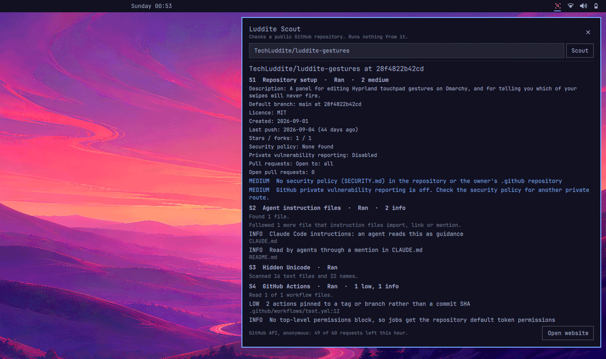

# Omarchy plugin

A bar widget and panel for the Omarchy desktop. It runs the same checks as the website and the terminal.

## Install

```sh
omarchy plugin add https://github.com/TechLuddite/Luddite-Scout
omarchy plugin enable io.github.techluddite.luddite-scout
```

The plugin needs `/usr/bin/python3`, which Omarchy ships. It has no settings.

## Use

The bar icon opens a panel. Type a repository as `owner/repo` or a github.com URL and press Enter. The panel runs `bin/scout --json` under `/usr/bin/timeout`, which stops a scan after four minutes, and shows the report.



The panel shows up to eight findings per check. The website or the terminal shows the rest. Open website, at the bottom of the panel, opens https://techluddite.github.io/Luddite-Scout/ in your browser.

If you are signed in to the GitHub CLI (`gh auth login`), the panel uses that login, which raises GitHub's limit from 60 to 5,000 requests an hour. The token stays inside `bin/scout` and is sent only to `api.github.com`. Without a login the panel works anonymously.

## What it touches

- It starts one process per scan: `/usr/bin/timeout` running `/usr/bin/python3 -I -S bin/scout`, with a cleared environment and a fixed `PATH`.
- It reads at most about 2 MB of the scan's output and renders all of it as plain text.
- It writes no files and keeps no state, cache, credentials or configuration.
- It contacts the four hosts listed in [data handling](data-handling.md), through `bin/scout` only.

## Remove

```sh
omarchy plugin remove io.github.techluddite.luddite-scout
```

Nothing is left behind, because the plugin keeps nothing outside its own folder.
